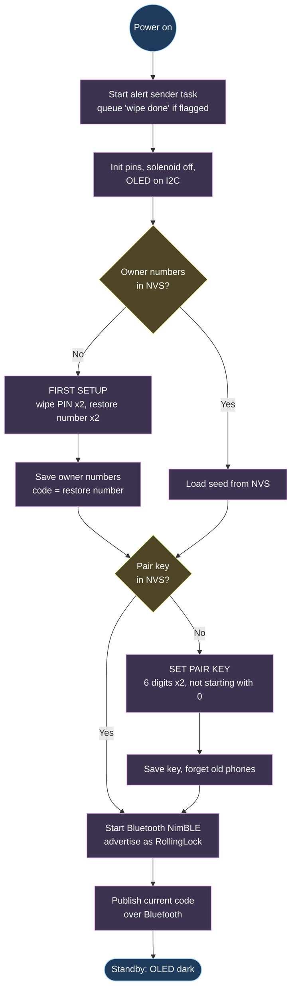
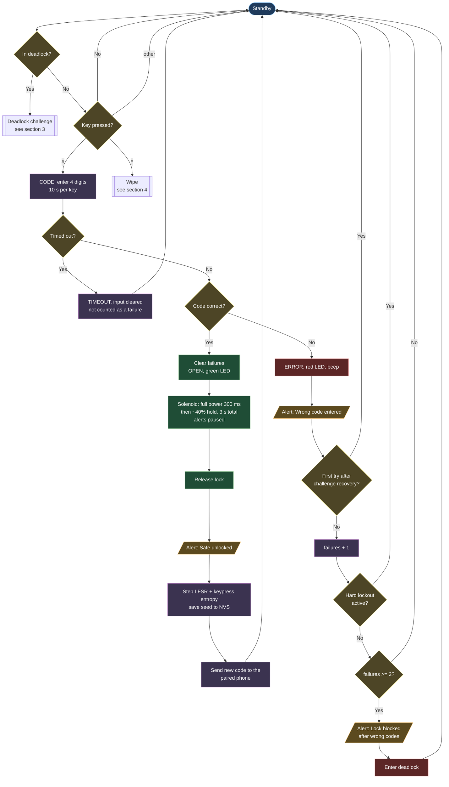
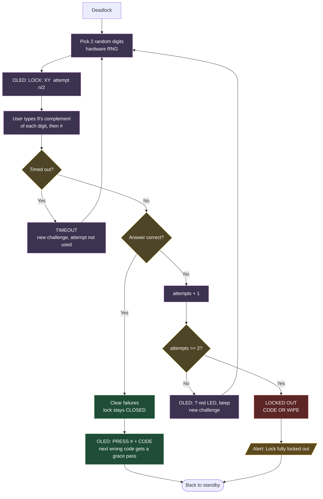
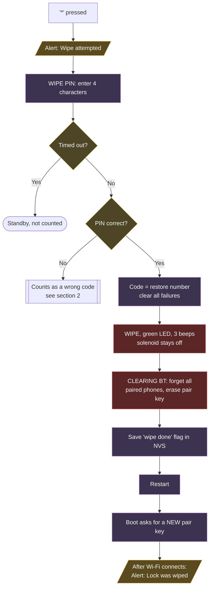
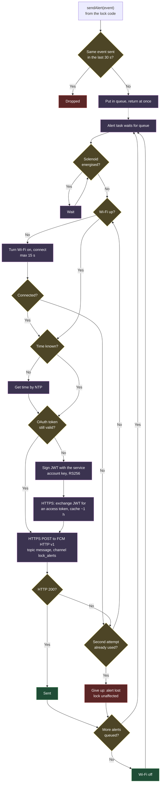
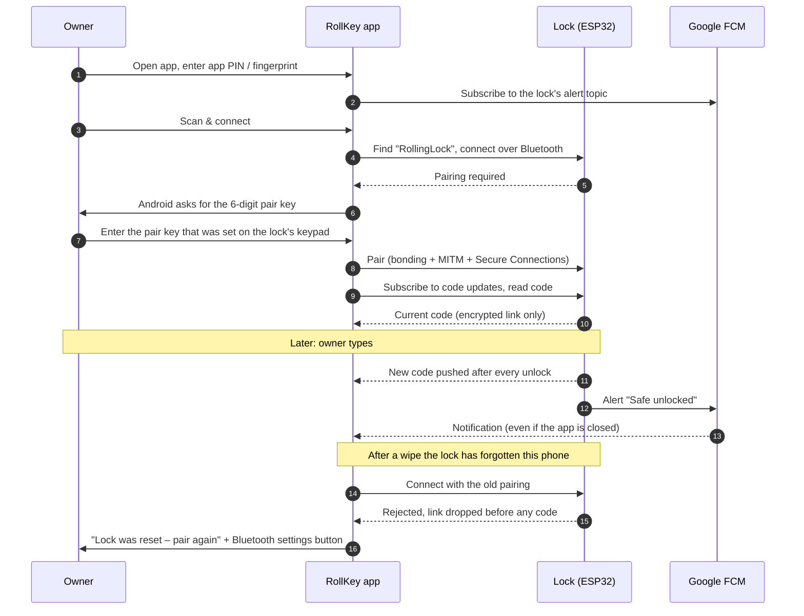

# System Flowcharts

How the RollKey lock behaves, taken from the main firmware
[`rolling_code_lock_esp32_alerts`](../firmware/esp32/rolling_code_lock_esp32_alerts/)
and the Android app. GitHub renders these diagrams automatically.

1. [Power-up and first setup](#1-power-up-and-first-setup)
2. [Main loop: code entry, unlock and failures](#2-main-loop-code-entry-unlock-and-failures)
3. [Deadlock challenge and hard lockout](#3-deadlock-challenge-and-hard-lockout)
4. [Wipe](#4-wipe)
5. [Push alert sender (background task)](#5-push-alert-sender-background-task)
6. [Phone pairing and code delivery](#6-phone-pairing-and-code-delivery)

---

## 1. Power-up and first setup

- Values are typed twice; a mismatch asks again. Entry on the OLED is masked.
- The owner numbers are permanent. Only *Erase All Flash* on upload resets them.

---

## 2. Main loop: code entry, unlock and failures

- The OLED wakes on `#` or `*` and goes dark again in standby.
- The next code is **never shown on the OLED**; it only goes to the paired phone.
- During hard lockout a correct code still opens the lock and clears the lockout.

---

## 3. Deadlock challenge and hard lockout

Example: the OLED shows `LOCK:27`, so the answer is `72#`.

---

## 4. Wipe

Phones that were paired before the wipe must **unpair** in Android Bluetooth settings and pair again with the new key. The app detects this case (see section 6).

---

## 5. Push alert sender (background task)

The lock code only calls `sendAlert(event)`, which returns immediately. A separate task does the network work, so the keypad, OLED and lock never wait.

- Only the **event type** is sent. Never a code, PIN, key or token.
- If the "Lock was wiped" alert fails, its NVS flag stays and it is retried on the next boot.
- The phone does not need to be on the same network; Google delivers the alert anywhere.

---

## 6. Phone pairing and code delivery

