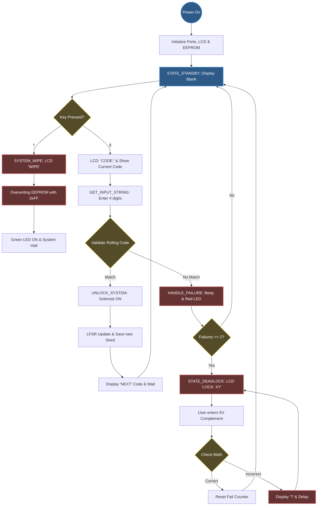

# System Logic Flowchart

## AVR Rolling Code Lock — State Machine

---

## Operation Guide

### Standard Entry
1. Press `#` to begin.
2. Enter the 4-digit rolling code.
3. **Success:** Solenoid triggers, next code is generated.

### Deadlock Recovery
- After 2 failed attempts: LCD shows `LOCK: XY`
- Calculate the **9's Complement** of both digits (e.g., `27` → enter `72#`).

### System Wipe (Factory Reset)
1. Press `*` from Standby.
2. LCD shows `WIPE`, EEPROM is cleared, Green LED stays on.
3. Power-cycle the device; it restarts with the default seed.

> **ESP32 version:** After a wipe the device also clears all paired BLE devices and prompts for a new Bluetooth passkey to be typed on the keypad.
